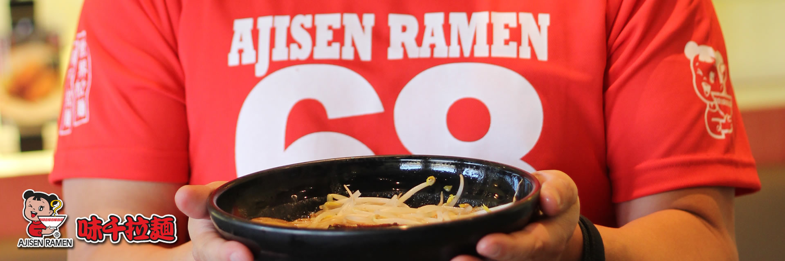

# Ajisen Ramen Restaurant Website

A multi-page restaurant website created as HTML/CSS coursework. The pages present restaurant information, food menus, promotions, and form layouts for a typical restaurant customer journey.

**Stack:** HTML · CSS · static image assets



## Pages

| Page | Content |
| --- | --- |
| [index.html](index.html) | Homepage and promotions |
| [aboutUs.html](aboutUs.html) | Restaurant information |
| [menu.html](menu.html) | Food menu presentation |
| [order.html](order.html) | Ordering interface |
| [contactUs.html](contactUs.html) | Contact-page layout and form |
| [recruitment.html](recruitment.html) | Recruitment information/form |
| [login.html](login.html), [register.html](register.html) | Account-form layouts |

## View locally

Open `index.html` directly in a browser, or run a local static server from the repository root:

```sh
python -m http.server 8000
```

Visit `http://localhost:8000` and follow the page navigation. Stop the server with Ctrl+C. No package installation, API keys, or database setup is required to inspect the static pages.

## Folder guide

- Root `*.html` files contain the individual pages.
- [css/](css/) contains page stylesheets. Some filenames contain spaces; preserve their exact spelling when changing links.
- [images/](images/) contains the supplied restaurant and menu assets.
- [readme.txt](readme.txt) preserves the original source note.

## Scope

The repository provides frontend pages. Their presence does not establish functioning customer accounts, saved orders, payments, recruitment submissions, or a contact-message delivery service. Do not enter real personal or payment details into the demonstration forms.

Restaurant branding and images are retained as part of the historical coursework. This is a student portfolio project, not a claim of affiliation with or an official website for Ajisen Ramen. Menu details and promotions should be treated as historical content.

## Reviewing changes

After editing a page, open it through the local server, follow its navigation links, and check that its stylesheet and images load. Check form behaviour and narrow-screen layouts separately; these manual browser checks have not been recorded as passing tests here.

## Credits and verification

The original presentation is credited to **Chua Jia Sheng**. Original proposal, presentation, and course brief are retained separately. Relative source paths were preserved during preparation; the site has not been audited for full browser compatibility, accessibility, or production use.
